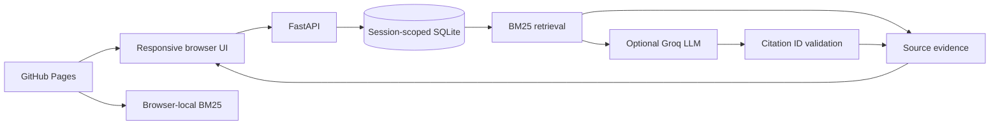

# N25X NOESIS — v0.2.0

Multilingual AI document research system · Portfolio MVP

Project initiator and owner: Natalie Ragulina (Netaniya). Developed with AI assistance; owner decisions, deployment participation and manual acceptance are recorded in the work log. No private Studio data or code is included.

[Live portfolio demo (GitHub Pages)](https://netaniya.github.io/n25x-knowledge-engine/) · [Full AI demo (Render)](https://n25x-noesis.onrender.com/) · [Deutsch](README.de.md)

## Working product
- German first-visit default; English and Russian selectable; three themes, responsive interface.
- Public AI demo: UTF-8 TXT/Markdown uploads, temporary isolated browser-session libraries, BM25 retrieval, source-scoped search, clickable evidence, TXT export.
- Real GPT-OSS 20B generation via Groq, with explicit consent. Document-only answers and separate general model knowledge; citations are source IDs, not a guarantee of factual correctness.
- GitHub Pages fallback: actual browser-local BM25 search, no server or key, no AI generation. Data clears on reload; link to the full app.
- Local installation also supports text PDFs up to 5 MB / 150 pages, SQLite and optional embedding adapters.

## Run locally (Python 3.12 or 3.13)
```bash
git clone -b feature/hybrid-retrieval https://github.com/Netaniya/n25x-knowledge-engine.git
cd n25x-knowledge-engine
python -m venv .venv
# Linux/macOS: source .venv/bin/activate
# Windows PowerShell: .\.venv\Scripts\Activate.ps1
python -m pip install -r requirements-dev.txt
python -m pytest -q
python -m uvicorn app.main:app --host 127.0.0.1 --port 8000
```
Open http://127.0.0.1:8000. API docs: http://127.0.0.1:8000/docs. Docker: `docker compose up --build` (localhost binding). See [public AI configuration](docs/PUBLIC_AI.md) and [hybrid retrieval ADR](docs/adr/0001-hybrid-retrieval.md). Never commit secrets.

## Architecture


## Verification and limits
[CI 46002577620](https://github.com/Netaniya/n25x-knowledge-engine/actions/runs/46002577620): Python/API, optional Qdrant, Docker and Chromium smoke passed for app commit 85c83967f539beb653d3d8ee55d2a207cb20027d. Live Russian positive/negative RAG acceptance by owner; German and English live scenarios independently exercised. See [acceptance](docs/ACCEPTANCE.md), [work log](docs/WORK_LOG.md) and [documentation-based comparison](docs/BENCHMARK.md).

Free Render hosting may sleep or become temporarily unavailable. Public AI limits: 3 calls/minute, 30/24h globally, 6/session/24h (temporary counters can reset); provider limits also apply. Test data only; no confidential documents. Public demo accepts TXT/Markdown up to 1 MB, not PDF. No production authentication, persistent cloud storage, OCR, or conversation history. Semantic adapters are implemented but public demo uses BM25; real embedding quality is not validated. No claim of competitor superiority, comprehensive security audit or zero hallucinations.

© 2026 Natalie Ragulina (Netaniya). All rights reserved for project-owned material. Third-party components retain their licenses. No open-source license has been selected.
