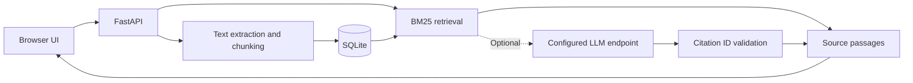

# N25X NOESIS — portfolio MVP

**[Live portfolio (GitHub Pages)](https://netaniya.github.io/n25x-knowledge-engine/) · [Live AI application](https://n25x-noesis.onrender.com/) · [Current implementation and documentation](https://github.com/Netaniya/n25x-knowledge-engine/tree/feature/hybrid-retrieval)**

Project owner: Natalie Ragulina (Netaniya). AI-assisted development; contributions and acceptance are documented in the current implementation branch. The main branch below is the earlier local baseline, not the deployed release. Current release documentation: [English](https://github.com/Netaniya/n25x-knowledge-engine/blob/feature/hybrid-retrieval/README.md) · [Deutsch](https://github.com/Netaniya/n25x-knowledge-engine/blob/feature/hybrid-retrieval/README.de.md) · [Acceptance](https://github.com/Netaniya/n25x-knowledge-engine/blob/feature/hybrid-retrieval/docs/ACCEPTANCE.md).

---


# N25X Knowledge Engine

**Version 0.1.3 — local document retrieval MVP**

Project owner and initiator: Natalie Ragulina (Netaniya). Initial implementation developed with AI assistance. A standalone portfolio project for evidence-based document search. No private NETA25X Studio code or documents are included.

[Deutsch](README.de.md) · [English](README.md)

## Features

- Upload UTF-8 TXT, Markdown and text-based PDF documents (5 MB each, max. 150 PDF pages).
- Persist extracted passages and PDF page numbers in SQLite; delete a document and its passages.
- Rank relevant passages using BM25 lexical retrieval. Each result includes a source ID, filename, optional PDF page, and passage.
- Offline mode returns passages, not a fabricated AI answer. Optional generation uses a configured OpenAI-compatible endpoint and validates that cited source IDs exist. Citation validity does not prove factual correctness.
- German (default), English and Russian interface with persistent language selection, a fictional sample document, and clickable source citations.
- Three switchable UI themes (night blue, deep turquoise, light turquoise), saved locally in the browser.
- Browser UI, REST API and OpenAPI documentation; automated tests and a GitHub Actions CI definition.

## Local quick start (Python 3.12 or 3.13)

```bash
python -m venv .venv
# Linux/macOS
source .venv/bin/activate
# Windows PowerShell alternative: .\.venv\Scripts\Activate.ps1
python -m pip install -r requirements-dev.txt
python -m pytest -q
python -m uvicorn app.main:app --host 127.0.0.1 --port 8000
```

Open http://127.0.0.1:8000 and upload samples/demo-de.txt. Ask "Was ist die Supportzeit?". Expected evidence: Monday–Friday, 09:00–17:00. API docs: http://127.0.0.1:8000/docs.

## Docker (configuration supplied, build not tested in authoring environment)

```bash
docker compose up --build
```

The service binds to localhost; SQLite persists in a named volume.

## Optional generation

Set environment variables LLM_API_KEY and LLM_MODEL before starting. LLM_BASE_URL defaults to https://api.openai.com/v1; select a model supported by the provider. The UI's explicit AI checkbox enables sending the question and retrieved text to that endpoint. API charges may apply. Do not upload confidential documents. No key is needed for retrieval. Never commit keys.

## Architecture



## Current limitations / next milestones

Local single-user demo only: no authentication, tenancy, OCR, streaming, rate limiting, or production security hardening. Lexical retrieval does not understand semantic paraphrases. PDF processing can be resource intensive; do not expose the upload endpoint publicly. The optional generator may still hallucinate even if citation IDs are valid; use source inspection and evaluation. No live model call was performed during initial testing. Docker and remote CI are not yet verified.

Next: semantic embeddings and Qdrant vector retrieval; LangChain integration; retrieval and answer evaluation; React/TypeScript frontend; CI verification; Kubernetes, observability and authenticated cloud demo. These are planned features, not current capabilities.

## German portfolio description

Eigenständiger Prototyp für dokumentenbasierte Recherche mit Python/FastAPI, SQLite und BM25-Retrieval. Dokumente werden eingelesen, in Textabschnitte aufgeteilt und anhand relevanter Suchbegriffe ausgewertet. Quellen werden transparent angezeigt; optional ist eine Anbindung an einen konfigurierbaren LLM-Endpunkt vorgesehen. REST-API, automatisierte Tests sowie Docker- und CI-Konfiguration sind enthalten. Semantische Vektorsuche, LangChain, Kubernetes und Cloud-Deployment sind nächste Entwicklungsschritte.

## Contributions and verification

See [work log](docs/WORK_LOG.md), [learning notes](docs/LEARNING.md) and [test results](docs/test-results.txt). The owner reported a first manual review and test of v0.1.1; detailed test cases and second acceptance pass remain pending. See the work log. No open-source license has been selected; public visibility alone does not grant a license.

## Scoped research and evidence export

Select the documents to search, then choose 1, 2, 4, 6 or 8 passages. The API accepts optional `document_ids`: omitted/null means all, an empty list means no sources. Filtering takes place before ranking and optional generation. Each result shows its BM25 relevance score (not a confidence probability). Export the question, answer mode, answer and evidence to a UTF-8 text file locally; exported data may contain private document excerpts. The selected scope applies to the next query. Results are not translated automatically when the interface language changes.
